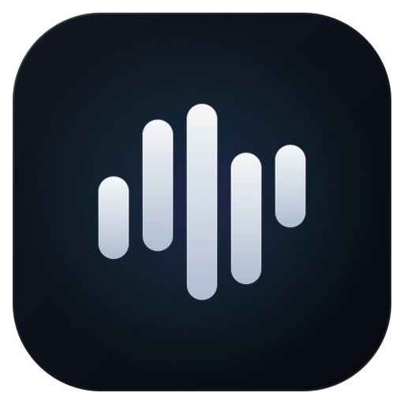

<div align="center">



# Sonora

**More than listening.**

*A music player for listeners and musicians, focused on simplicity, performance and reliability.*

</div>

---

## Overview

Sonora is an open-source, GPLv3-licensed music client for Android, Wear OS and Android TV. It combines high-resolution playback and a clean, frosted-glass interface with practical tools for musicians — including offline live chord detection, transposition, capo helpers and word-synced lyrics.

> **Disclaimer:** Sonora is an independent, community-developed client and is not affiliated with, endorsed by, or connected to Google LLC, YouTube Music, Spotify, Apple, or any third-party media service. Sonora does not host or distribute copyrighted media.

---

## Features

### Implemented

- **Playback & Audio**
  - Search, browse and stream via YouTube Music, plus configurable Hi-Res lossless module sources (FLAC/ALAC).
  - Gapless playback, adjustable crossfade (0–12 s), Automix and local music library integration.
  - Bit-perfect USB DAC exclusive output, DSD/DST decoding, playback speed control, skip silence, system equalizer and sleep timer.
  - Offline downloads with embedded metadata and background playback under standard Android battery optimisation.
- **Musician & Lyrics Tools**
  - **Live Chords (Offline):** Chroma-based major, minor and seventh-chord detection with cached analysis, chord simplification, transposition, guitar diagrams and capo support.
  - **Word-Synced Lyrics:** Syllable/word-level highlighting, translation and romanization across multiple lyrics providers.
- **Interface & Controls**
  - Frosted-glass Material 3 interface with dynamic artwork theming and animated album canvas.
  - Appearance refresh-rate selector (60 / 90 / 120 Hz, respecting device display modes).
  - Stats for nerds (codec, bit depth, sample rate).
- **Connectivity & Platforms**
  - Google account sign-in, Spotify playlist/library import, Last.fm and ListenBrainz scrobbling, Discord Rich Presence.
  - Casting to AirPlay (RAOP), DLNA/UPnP and Chromecast.
  - **Listen Together:** Compatible with legacy BitChord Listen Together rooms.
  - Android Phone (`app/`), Wear OS (`wearos/`) and Android TV (`tv/`).

### Planned

- Dedicated Sonora release distribution and self-hosted service endpoints.
- Multi-ABI Rust core builds (`armeabi-v7a`, `x86_64`) with automated Gradle compilation and production-equivalent (`prodRelease`) benchmarks.
- Expanded piano chord diagrams and refined multi-instrument harmony tools.
- Dedicated Android TV launcher banner artwork and complete non-English translations for newly added Replay/AutoMix strings.

---

## Project Structure

```text
app/          Android phone application (Kotlin, Jetpack Compose, Media3, C++/JNI)
shared/       Shared Kotlin Multiplatform domain, networking, lyrics and chord logic
sharedUi/     Shared Compose UI components (player, lyrics, chords, artwork backdrops)
native/       C++ audio/DSP analyzers and portable Rust core (sonora-core, sonora-android)
wearos/       Wear OS companion remote
tv/           Android TV Leanback client
backend/      Optional Go Listen Together server
web/          Web client and companion extension
```

---

## Building from Source

### Requirements

- **JDK 21** (Android Studio bundled JDK recommended)
- **Android SDK** (`compileSdk = 37`, `minSdk = 26`)
- **CMake 3.22.1+** and **Android NDK 27**
- **Rust (Optional):** Stable Rust with `aarch64-linux-android` target if rebuilding `native/sonora-android` (pre-built `arm64-v8a` binary is included; other ABIs use the Kotlin fallback).

### Build & Test

```bash
# Build Android phone debug APK (skipping Wear bundling)
./gradlew :app:assembleProdDebug -Pbitchord.bundleWear=false

# Build Wear OS and Android TV debug APKs
./gradlew :wearos:assembleProdDebug :tv:assembleProdDebug

# Run unit tests
./gradlew :shared:jvmTest :sharedUi:jvmTest :app:testProdDebugUnitTest -Pbitchord.bundleWear=false
```

On Windows PowerShell, quote `-P` flags containing dots:

```powershell
.\gradlew.bat :app:assembleProdDebug "-Pbitchord.bundleWear=false"
```

---

## Documentation

- [CONTRIBUTING.md](CONTRIBUTING.md) — Contribution guidelines, build setup and licensing rules.
- [MAINTAINERS.md](MAINTAINERS.md) — Project stewardship and upstream contributor recognition.
- [AUDIT.md](AUDIT.md) — Independent technical debt and architecture audit.
- [PERFORMANCE.md](PERFORMANCE.md) — Performance optimisation notes and measured device benchmarks.
- [RUST_MIGRATION.md](RUST_MIGRATION.md) — Portable Rust core architecture and JNI interface reference.

---

## Upstream Acknowledgements & License

Sonora is derived from **[BitChord](https://github.com/kushagrasinghx/BitChord)**, originally created by **Kushagra Singh (`@kushagrasinghx`)** and the BitChord contributors listed in [MAINTAINERS.md](MAINTAINERS.md). Sonora preserves BitChord's core architecture, Kotlin/JNI compatibility and Listen Together interoperability.

Additional upstream credits:
- Lyrics animation and providers: `am-lyrics` (`binimum`), `lrc.red`, `BiniLyrics`, `BetterLyrics`, `PaxSenix`, `LyricsPlus`, `SimpMusic`, `Unison`, `Megalobiz`, `KuGou`, `LRCLIB`, `Musixmatch` and `Genius`.
- Bit-perfect USB DAC reference: `Mornye`.
- Audio DSP libraries: `signalsmith-stretch`, `signalsmith-linear`, `Oboe` and `FFmpeg`.

Sonora is free software licensed under the **GNU General Public License v3.0 (GPLv3)**. See [LICENSE](LICENSE) for full terms.
